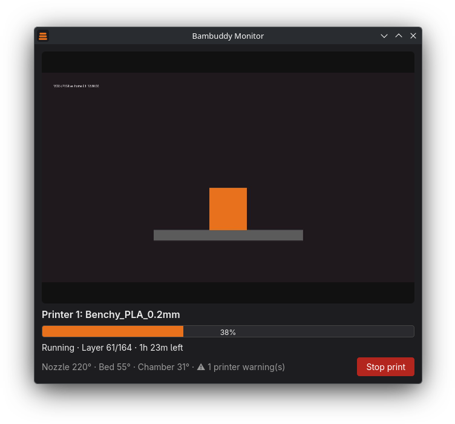

<div align="center">


# Bambuddy Monitor

**Start a print and your camera and progress pop up on their own.**
A tiny Linux tray app for [Bambuddy](https://github.com/maziggy/bambuddy).

[](https://github.com/shatteredeagle/bambuddy-monitor/actions/workflows/ci.yml)
[](LICENSE)



<sub>Screenshot uses a simulated printer.</sub>

</div>

## Overview

Bambuddy already has a web UI and camera wall, but you have to remember to open them. Bambuddy Monitor sits in your system tray, watches your printers through the Bambuddy API, and **opens a window by itself when a print starts**. When the print ends it tells you, then tucks itself away.

It never talks to the printer directly. It only needs your Bambuddy URL and an API key.

## Features

- **Auto popup** when a printer goes from idle to preparing, running or paused. If a print is already running when you launch it, it pops up once.
- **Live camera** from Bambuddy's MJPEG stream. Bambuddy fans one printer connection out to every viewer, so the monitor, the web UI and other apps can all watch at the same time.
- **Print status:** progress, layer, time remaining, nozzle / bed / chamber temperatures and a printer-warning count.
- **Stop print** button, with an inline confirm so it can't be hit by accident.
- **Alerts** as desktop notifications, each one a switch in Settings:
  - print finished, failed or stopped, and paused
  - **out of filament** and other printer warnings (a warning that needs you also opens the window)
  - **filament low**, when the spool in use drops to 15% or less
  - printer went offline
- The window hides itself a while after a print ends (configurable).
- **Light on resources:** a small Rust process polling every 3 seconds. The window and its webview only exist while the window is shown, and the camera stream is released when it closes.
- **Update check:** looks for a newer release once a day (switch it off in Settings) and tells you; the tray menu has **Check for updates…**, which opens the download page. It never replaces itself, so `.deb`, `.rpm` and Arch installs stay under your package manager's control.
- Watch **all printers** or pick **one**.
- One instance at a time. Follows your light or dark theme.

## Install

Download a package from the [latest release](../../releases/latest):

| Distro | Package |
|---|---|
| Debian, Ubuntu | `.deb` |
| Fedora, openSUSE | `.rpm` |
| Arch | `.pkg.tar.zst`, or `makepkg -si` from a clone |
| Anything else | `.AppImage` |

Runtime needs `webkit2gtk-4.1`, `gtk3` and `libayatana-appindicator`. Your desktop must display tray icons. KDE Plasma does (the only desktop tested so far); GNOME needs the AppIndicator extension, and other desktops may need a StatusNotifier or AppIndicator tray plugin.

## Set up

1. Launch **Bambuddy Monitor**. The first run opens Settings.
2. Enter your Bambuddy URL (for example `https://bambuddy.example.com`) and an API key from **Bambuddy > Settings > API Keys**.
3. Click **Load printers**, optionally choose one printer, and **Save**.

That's it. Right-click the tray icon for **Show**, **Settings** and **Quit**. To start it at login, copy its `.desktop` file to `~/.config/autostart/`.

Settings are stored in `~/.config/bambuddy-monitor/config.json` (readable only by you). The API key is stored in plain text there, like most small desktop tools. Use a key with only the permissions you need.

## How it works

```
Bambuddy ──REST──▶ Rust poller (every 3 s) ──▶ pops the window on a print start
    └────MJPEG camera stream────────────────▶ webview  (only while open)
```

The poller reads `/printers/{id}/status`. The window is a small webview that shows the camera stream directly, so no video code is needed. Stop print calls `/printers/{id}/print/stop`. Alerts are worked out from the status it already polls: state changes, new printer warnings (out of filament is recognised from the warning text), the spool in use, and the connection. Nothing is reported on the first look after launch, so restarting the app doesn't replay old problems.

## FAQ

**Does it work with Bambu Studio or Handy at the same time?** Bambuddy Monitor only talks to Bambuddy, so it never competes for the printer's single camera connection. Apps that connect straight to the printer may.

**GNOME shows no tray icon.** Install the AppIndicator / KStatusNotifierItem extension.

**The taskbar shows a generic icon.** Install a package rather than running the bare binary. The icon is matched by the installed `.desktop` file.

**Windows or macOS?** Tauri supports both, but only Linux is built and tested so far.

## Build from source

Needs Rust, `webkit2gtk-4.1` and `libayatana-appindicator` (plus their `-dev` packages on Debian-based systems).

```sh
cd src-tauri
cargo build --release          # binary at src-tauri/target/release/bambuddy-monitor
cargo install tauri-cli --locked
cargo tauri build              # .deb / .rpm / AppImage
```

`tools/make-icons.py` re-renders the PNG icons from `bambuddy-monitor.svg` (needs PySide6). Pushing a `vX.Y.Z` tag builds and publishes a release (see `.github/workflows/release.yml`); the tag must match the version in `Cargo.toml` and `tauri.conf.json`.

## Not affiliated

An unofficial community project. Bambuddy is by [maziggy](https://github.com/maziggy/bambuddy). Bambu Lab is a trademark of its owner; this project is not affiliated with or endorsed by either.

## Licence

[AGPL-3.0-or-later](LICENSE)
